<p align="center">
  
</p>

<h1 align="center">safemerge</h1>

<p align="center">
  <b>Saiba se a sua branch pode ser mergeada antes do merge acontecer.</b><br>
  Conflitos (inclusive com outros PRs e os que o git não vê), segurança e riscos de produção do que a branch introduz.
</p>

<p align="center">
  <a href="https://github.com/joaocarpim/safe-merge/actions/workflows/ci.yml"></a>
  
  
  <a href="https://marketplace.visualstudio.com/items?itemName=JooVitorAparecidoCarpimdeSouza.safemerge"></a>
  <a href="LICENSE"></a>
  <a href="https://github.com/joaocarpim/safe-merge/stargazers"></a>
</p>

<p align="center">
  <a href="#instalação">Instalação</a> ·
  <a href="#formas-de-usar">Formas de usar</a> ·
  <a href="#o-que-ele-analisa">O que analisa</a> ·
  <a href="#todas-as-situações">Galeria</a> ·
  <a href="docs/CAPACIDADES.md">Referência completa</a>
</p>

<p align="center">
  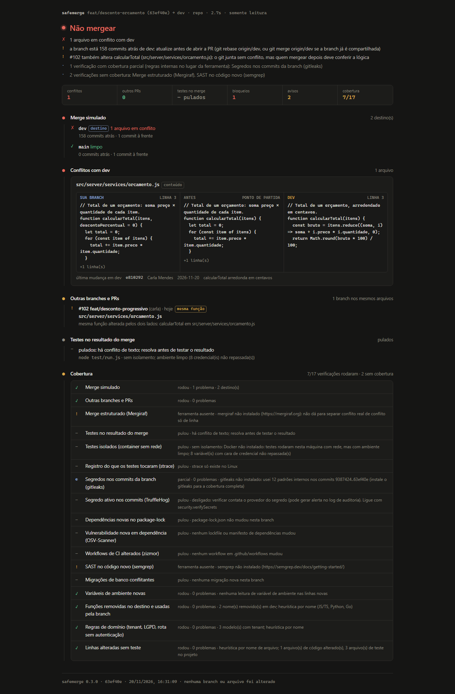
</p>

---

## Por que existe

O git só avisa do conflito **na hora do merge**, e só do conflito de texto. Num time com vários PRs
abertos, o que quebra produção costuma ser outra coisa:

- dois PRs que **cada um passa sozinho** e juntos conflitam ou quebram os testes;
- a `dev` **renomeou uma função** que o seu PR ainda chama: o git junta sem reclamar e o deploy quebra;
- um token **commitado e apagado** no commit seguinte, que continua no histórico;
- uma dependência nova com **script de instalação** (o vetor de worms como o Shai-Hulud);
- uma **migração com o mesmo número** que outra branch, ou mais antiga que uma já aplicada;
- o código novo com **N+1, HTTP sem timeout, SQL concatenado, `.env` commitado**.

O safemerge responde, **antes** do merge e **sem alterar nada** no seu repositório:

> **Pode mergear?** Se não, por quê, onde (arquivo e linha), com a evidência, e o que **não** foi verificado.

## Destaques

| | |
| --- | --- |
| 🔀 **Merge de verdade, sem tocar em nada** | `git merge-tree` com o destino e com cada PR aberto. Conflito mostrado com a sua branch, como era antes e o destino |
| 🧪 **Conflito que o git não vê** | roda os seus testes no resultado do merge e diz se a culpa é da junção, da sua branch ou do destino |
| 🔐 **Segurança do que a branch introduz** | segredos em todos os commits, dependência suspeita, CVE nova, workflow de CI perigoso, SAST só no código novo |
| 🧭 **Revisor sênior automático** | N+1, HTTP sem timeout, exceção engolida, SQL concatenado, migração destrutiva, LGPD, tenant, rota sem autenticação |
| 📋 **Cobertura explícita** | cada verificação diz se rodou, rodou parcialmente, pulou ou ficou sem ferramenta. Nunca "0 problemas" sem ter verificado |
| 🤖 **IA que propõe e é conferida** | gera o pedido para o seu assistente de IA e verifica a resposta e a resolução proposta antes de você aplicar |
| 🧩 **Onde você estiver** | terminal, extensão do VS Code, hook pre-push, GitHub Actions (com anotações no diff do PR), SARIF, Markdown, HTML |

## Medido

Num cenário de produção incluído no repositório ([`examples/make-demo-complex.sh`](examples/make-demo-complex.sh):
~150 módulos, 160 commits na `dev` e **18 branches abertas**, cada uma com uma situação diferente),
sem nenhuma ferramenta externa instalada:

| Métrica | Resultado |
| --- | --- |
| Situações plantadas detectadas | **34 de 34** |
| Veredito certo | **18 de 18** branches |
| Alarmes falsos | **0** |
| Tempo por branch (Windows, com a suíte de testes no merge) | mediana **2,2 s** |

Reproduza com `npm run test:complex`. O cenário foi escrito junto com a ferramenta; o número que
importa é o do seu repositório.

---

## Instalação

**Requisitos:** Node.js 20+ e git 2.38+.

```bash
npm install -g github:joaocarpim/safe-merge
safemerge --help
```

<details>
<summary>A partir do código (para contribuir)</summary>

```bash
git clone https://github.com/joaocarpim/safe-merge.git
cd safemerge
npm install        # instala e compila
npm link           # deixa o comando "safemerge" no terminal
npm test           # 169 testes
```

</details>

Ferramentas externas são **opcionais** e aumentam a cobertura (veja [a tabela](#ferramentas-externas-opcionais)).
Sem elas, o safemerge usa regras internas e diz isso no relatório.

---

## Formas de usar

| Forma | Para quem | Começa em |
| --- | --- | --- |
| [1. Terminal](#1-terminal) | quem quer o veredito antes de abrir o PR | 1 comando |
| [2. Extensão do VS Code](#2-extensão-do-vs-code) | quem quer ver o conflito dentro do código | instalar pela aba Extensões |
| [3. Com o seu assistente de IA](#3-com-o-seu-assistente-de-ia) | quem usa Claude Code, Cursor, Copilot… | colar um pedido |
| [4. Hook pre-push](#4-hook-pre-push) | quem quer ser barrado antes de enviar | 1 comando |
| [5. GitHub Actions](#5-github-actions) | o time inteiro, em todo PR | 1 arquivo |
| [6. Visão do time](#6-visão-do-time-matrix) | quem cuida de vários PRs | `safemerge matrix` |

### 1. Terminal

**Passo a passo:**

```bash
# 1. entre no projeto e na branch que você quer mergear
cd meu-projeto
git checkout feature/minha-branch

# 2. analise (o destino é detectado: dev, develop, staging… senão main)
safemerge

# 3. se o projeto tem testes, rode-os no resultado do merge (pega conflito semântico)
safemerge --test-cmd "npm test"
```

<p align="center">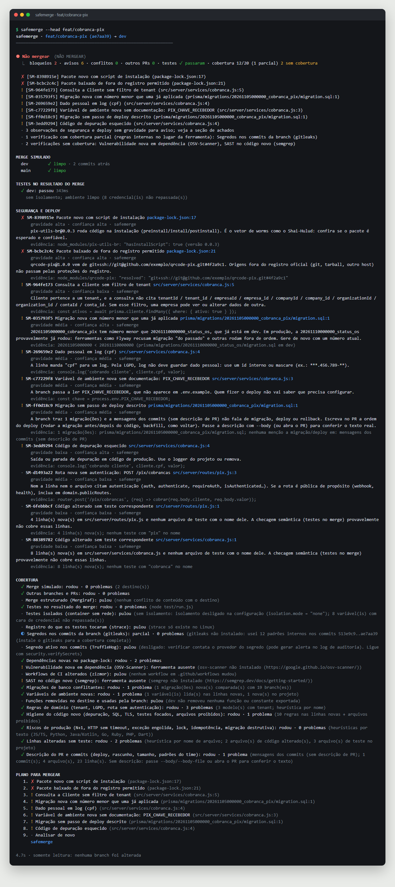</p>

**Opções mais usadas:**

```bash
safemerge --base main                  # escolhe o destino
safemerge --head feature/outra         # analisa outra branch sem trocar de branch
safemerge --format markdown            # para colar no PR (também json, html, sarif, github, prompt)
safemerge --format prompt              # pedido pronto para o seu assistente de IA
safemerge --sarif resultado.sarif      # para o GitHub Code Scanning
safemerge --save                       # guarda tudo em .safemerge/runs/<data>/ (txt, md, html, json, sarif)
safemerge --fail-on warn               # sai com erro também nos avisos (para CI)
safemerge --no-fetch --no-prs          # sem rede
```

Códigos de saída: `0` pode mergear · `1` o veredito atingiu `--fail-on` (padrão: `block`) · `2` erro de uso.

<details>
<summary>Todos os comandos</summary>

| Comando | O que faz |
| --- | --- |
| `safemerge` | analisa a branch atual |
| `safemerge matrix` | todas as branches abertas × categoria |
| `safemerge replay --limit 200` | refaz os merges antigos e conta conflitos (git × Mergiraf) |
| `safemerge render --report r.json --format html` | formata um relatório salvo sem refazer a análise |
| `safemerge verify-text --report r.json texto.md` | confere ids, commits, PRs, `arquivo:linha` e números escritos por uma IA |
| `safemerge verify-resolution --target dev --file a.js=proposta.js --test-cmd "npm test"` | testa uma proposta de resolução numa cópia temporária; nunca aplica |
| `safemerge install-hook` | instala o hook pre-push |

</details>

### 2. Extensão do VS Code

A extensão roda o safemerge (que já vem dentro dela) e mostra o resultado no editor: barra lateral,
conflito sublinhado, CodeLens, hover com o código do destino, painel com o relatório, botões para copiar,
salvar e mandar para a IA, e um som quando pode mergear.

**Instalação:**

1. No VS Code, abra **Extensões** (`Ctrl+Shift+X`), procure por **safemerge** e clique em **Instalar**. Ou, pelo terminal:
   ```bash
   code --install-extension JooVitorAparecidoCarpimdeSouza.safemerge
   ```
   Também está no [Marketplace](https://marketplace.visualstudio.com/items?itemName=JooVitorAparecidoCarpimdeSouza.safemerge).
2. Abra a pasta de um repositório git, clique no **escudo** na barra lateral e em **Analisar branch**.

Sem acesso ao Marketplace? Baixe o `safemerge-0.3.0.vsix` na página de [Releases](https://github.com/joaocarpim/safe-merge/releases) e use **Extensões** → `⋯` → **Instalar do VSIX…**.

| Conflito no código, na aba Problemas e na barra de status | CodeLens e hover com o código do destino e como era antes |
| --- | --- |
| 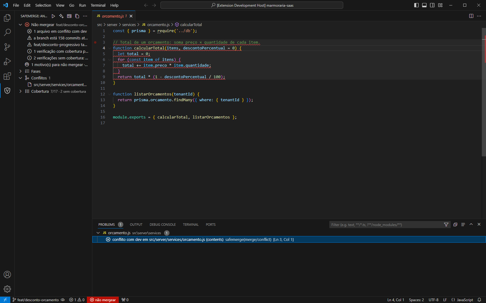 | 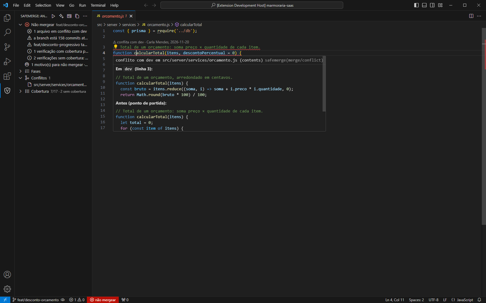 |
| **O relatório completo no painel** | **Segurança: achados na barra lateral e notificação** |
| 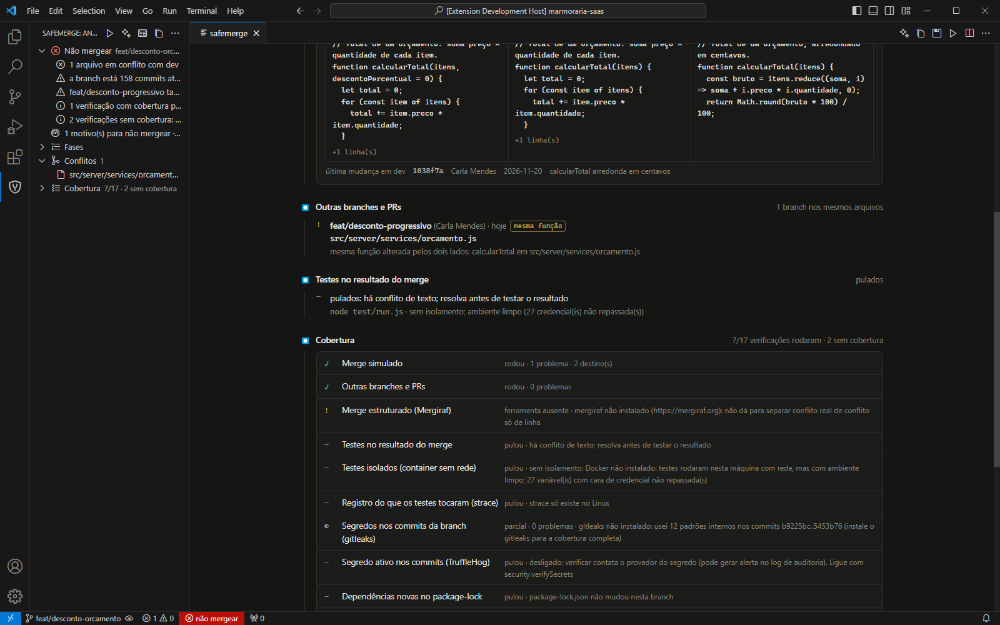 | 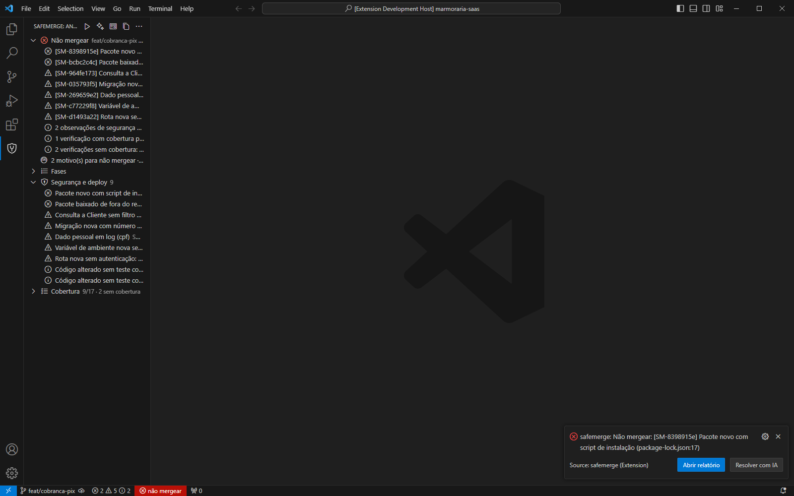 |

<details>
<summary>Comandos e configurações da extensão</summary>

| Comando | O que faz |
| --- | --- |
| `safemerge: Analisar branch` | analisa a branch aberta |
| `safemerge: Abrir relatório` | mostra o relatório completo |
| `safemerge: Resolver com IA` | manda o pedido para o chat do VS Code e copia para colar em qualquer assistente |
| `safemerge: Copiar relatório (texto)` / `Copiar para o PR (Markdown)` | para compartilhar |
| `safemerge: Salvar relatório…` | txt, md, html, pedido para IA, sarif ou json |
| `safemerge: Instalar hook pre-push` | barra o push de branch com "não mergear" |
| `safemerge: Testar som` | ouve os sons de pode mergear, atenção e não mergear |

| Configuração | Padrão | Para quê |
| --- | --- | --- |
| `safemerge.testCommand` | vazio | testes rodados no resultado do merge (ex.: `npm test`) |
| `safemerge.analyzeOnSave` | `false` | analisar ao salvar |
| `safemerge.sound` | `ok` | som: só quando pode mergear (`ok`), sempre (`always`) ou nunca (`never`) |
| `safemerge.soundStyle` | `safemerge` | som próprio ou do sistema |
| `safemerge.cliPath` | vazio | usar outra instalação do safemerge |

</details>

### 3. Com o seu assistente de IA

O safemerge **não chama nenhuma IA sozinho**. Ele entrega o que achou num formato pronto para o seu
assistente e **confere** o que a IA responder. A IA propõe; você decide.

**a) Cole o repositório no seu assistente** (Claude Code, Cursor, Copilot Chat, Codex…):

```text
Instale o safemerge (npm install -g github:joaocarpim/safe-merge) e rode
"safemerge --format prompt --save" na minha branch atual. Siga as regras do pedido que ele gerar:
explique cada problema, proponha a correção sem aplicar, verifique cada resolução de conflito com
"safemerge verify-resolution" e confira a sua resposta com "safemerge verify-text" antes de me mostrar.
```

**b) Gere o pedido você mesmo** e cole no chat:

```bash
safemerge --format prompt > pedido.md
```

O pedido traz os trechos dos dois lados de cada conflito, os achados com arquivo e linha, e as regras:
não aplicar sem confirmação, preservar a intenção dos dois lados e só citar números do relatório.

<details>
<summary>Exemplo: a IA inventou um id e uma contagem, e o <code>verify-text</code> pegou</summary>

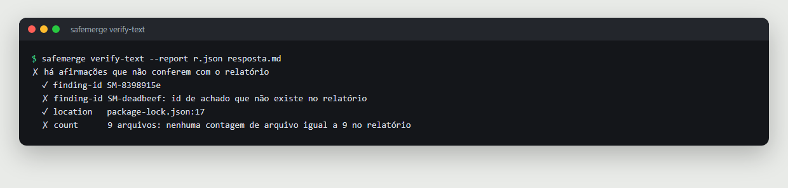

</details>

<details>
<summary>Exemplo: proposta de resolução verificada e proposta que quebra o teste</summary>

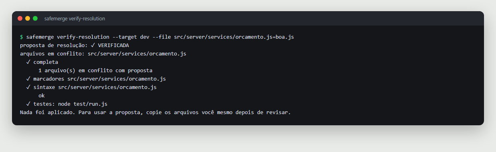
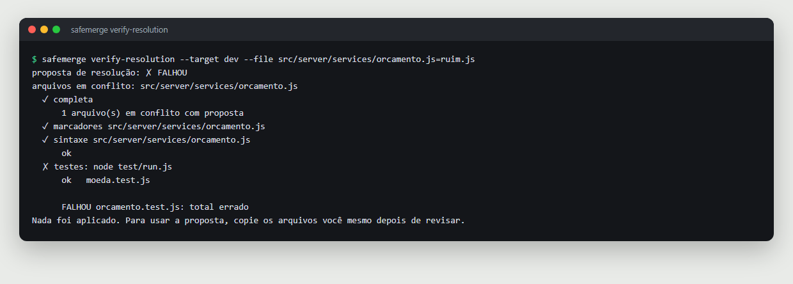

</details>

**c) Plugin do Claude Code** (skill `/safemerge` e agentes de testes, revisão e segurança):

```text
/plugin marketplace add joaocarpim/safe-merge
/plugin install safemerge@safemerge
/safemerge
```

A skill roda a CLI, decide a profundidade pelo risco, chama os agentes quando precisa e confere a
resposta final com `verify-text`. Detalhes em [`docs/SKILL-E-PLUGIN.md`](docs/SKILL-E-PLUGIN.md).

### 4. Hook pre-push

```bash
safemerge install-hook
```

Antes de cada `git push`, analisa as branches enviadas no modo rápido (merge simulado e outras branches,
limite de 20 s). Bloqueia só com **não mergear**; se o safemerge falhar, o push segue. Para pular uma vez:
`git push --no-verify`.

<p align="center">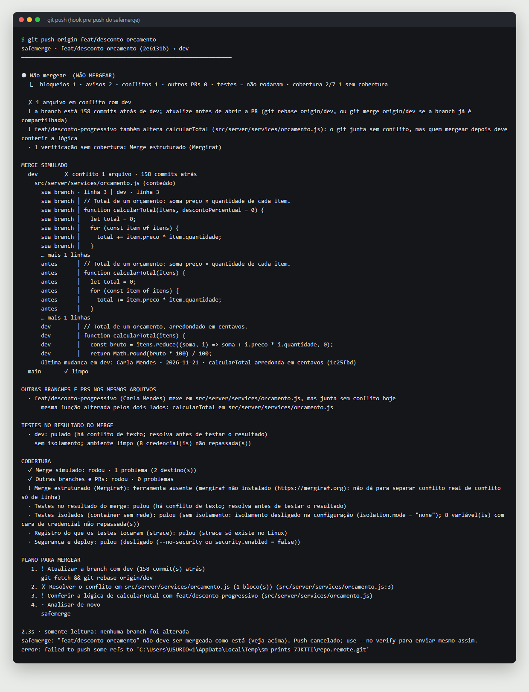</p>

### 5. GitHub Actions

Em cada PR: comenta o relatório, marca achados e conflitos **na linha do diff** e falha o job conforme
`fail-on`.

```yaml
# .github/workflows/safemerge.yml
name: safemerge
on:
  pull_request:

permissions:
  contents: read
  pull-requests: write

jobs:
  safemerge:
    runs-on: ubuntu-latest
    steps:
      - uses: actions/checkout@v4
        with:
          fetch-depth: 0
          persist-credentials: false
      - uses: actions/setup-node@v4
        with:
          node-version: 20
      - run: npm ci
      - uses: joaocarpim/safe-merge@v0.3.0
        with:
          test-command: npm test
          fail-on: block
```

Entradas: `test-command`, `build-command`, `fail-on` (`block`, `warn`, `never`), `comment` e
`github-token`. Saída: `level`. Exemplo comentado em
[`docs/exemplos/safemerge-workflow.yml`](docs/exemplos/safemerge-workflow.yml).

### 6. Visão do time (matrix)

```bash
safemerge matrix
```

Todas as branches abertas contra o destino, com o mesmo veredito da análise individual e a contagem por
categoria.

<p align="center">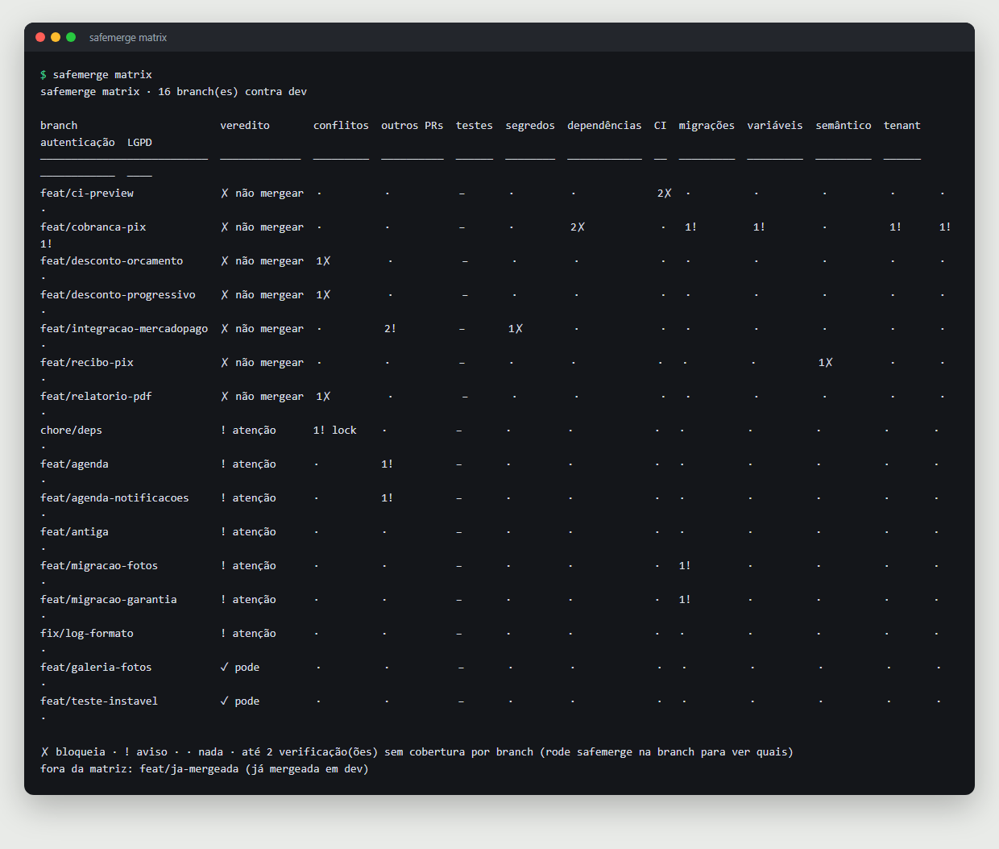</p>

---

## O que ele analisa

Resumo abaixo; a referência completa (como cada item é verificado e quando bloqueia) está em
[`docs/CAPACIDADES.md`](docs/CAPACIDADES.md).

| Área | Verificações |
| --- | --- |
| **Merge** | conflito com o destino e com as outras branches principais; apagado × alterado; conflito só em lockfile (aviso para regenerar); mesma função alterada pelos dois lados; renomeação no destino; branch atrasada; nada a mergear; conflito real × só de linha (Mergiraf) |
| **Outros PRs** | quem vai conflitar com a sua; quem altera a mesma função; PR empilhado; renomeações |
| **Testes no merge** | conflito semântico com a causa; teste instável repetido antes de acusar; build antes dos testes; Docker sem rede ou ambiente sem credenciais; strace no Linux |
| **Segurança** | segredos em todos os commits; segredo ativo (TruffleHog, opcional); dependência com script de instalação, de fora do registro ou sem integrity; CVE nova (OSV-Scanner); workflow de CI perigoso; SAST no código novo e no resultado do merge |
| **Deploy e domínio** | migração duplicada, fora de ordem ou mais antiga que uma aplicada; variável de ambiente nova; função removida no destino e ainda usada; dado pessoal em log (LGPD); rota sem autenticação; consulta sem filtro de tenant |
| **Revisão do código novo** | marcador de conflito commitado; SQL concatenado; `.env`/chave/credencial commitados; TLS/CSRF desligados; comparação de segredo com `==`; depuração esquecida; `.only`/`.skip`; N+1; HTTP sem timeout; exceção engolida; contador sem lock; idempotência sem reserva; transação com I/O; migração destrutiva; reformatação em massa |

**Como o veredito é decidido:** um achado só **bloqueia** com arquivo, linha e evidência, e com gravidade
e confiança acima do limite configurado. Heurísticas avisam, mas não bloqueiam sozinhas.

## Todas as situações

Todas as imagens são saídas reais da ferramenta no cenário de produção, geradas por
[`scripts/screenshots.mjs`](scripts/screenshots.mjs).

| Situação | Relatório |
| --- | --- |
| **Pode mergear.** Merge limpo, testes passaram no resultado do merge | [claro](docs/imagens/relatorio-pode-mergear.png) · [escuro](docs/imagens/relatorio-pode-mergear-escuro.png) |
| **Conflito de texto** com o destino, outro PR alterando a mesma função, branch atrasada | [claro](docs/imagens/relatorio-conflito-de-texto.png) · [escuro](docs/imagens/relatorio-conflito-de-texto-escuro.png) |
| **Conflito semântico.** O git junta sem conflito, os testes quebram só no merge | [claro](docs/imagens/relatorio-conflito-semantico.png) · [escuro](docs/imagens/relatorio-conflito-semantico-escuro.png) |
| **Segurança e deploy.** Sete problemas numa branch de cobrança por Pix | [claro](docs/imagens/relatorio-seguranca-e-deploy.png) · [escuro](docs/imagens/relatorio-seguranca-e-deploy-escuro.png) |
| **Workflow de CI perigoso.** `pull_request_target` com checkout do PR e título no shell | [claro](docs/imagens/relatorio-workflow-perigoso.png) · [escuro](docs/imagens/relatorio-workflow-perigoso-escuro.png) |
| **Segredo no histórico.** Token apagado no commit seguinte | [claro](docs/imagens/relatorio-segredo-no-historico.png) · [escuro](docs/imagens/relatorio-segredo-no-historico-escuro.png) |
| **Apagado × alterado.** A branch altera um arquivo que o destino apagou | [claro](docs/imagens/relatorio-apagado-x-alterado.png) · [escuro](docs/imagens/relatorio-apagado-x-alterado-escuro.png) |
| **Conflito só em lockfile.** Aviso para regenerar | [claro](docs/imagens/relatorio-lockfile.png) · [escuro](docs/imagens/relatorio-lockfile-escuro.png) |
| **Migrações.** Duas branches com migração de mesmo número | [claro](docs/imagens/relatorio-migracoes.png) · [escuro](docs/imagens/relatorio-migracoes-escuro.png) |
| **Teste instável.** Falhou e passou ao repetir: não é acusado | [claro](docs/imagens/relatorio-teste-instavel.png) · [escuro](docs/imagens/relatorio-teste-instavel-escuro.png) |
| **PR empilhado.** Precisa entrar depois de outro PR | [claro](docs/imagens/relatorio-pr-empilhado.png) · [escuro](docs/imagens/relatorio-pr-empilhado-escuro.png) |
| **Renomeação.** O destino renomeou o arquivo que a branch alterou | [claro](docs/imagens/relatorio-renomeacao.png) · [escuro](docs/imagens/relatorio-renomeacao-escuro.png) |
| **Nada a mergear.** A branch já está no destino | [claro](docs/imagens/relatorio-nada-a-mergear.png) · [escuro](docs/imagens/relatorio-nada-a-mergear-escuro.png) |

<details>
<summary>Ver o relatório de segurança e deploy completo</summary>

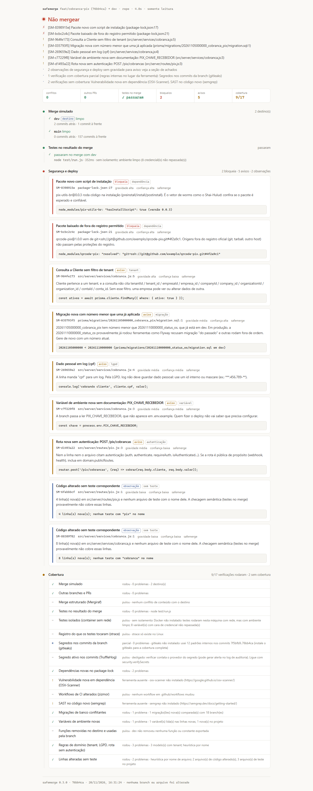

</details>

<details>
<summary>Mais saídas do terminal (pode mergear, replay, erro explicado)</summary>

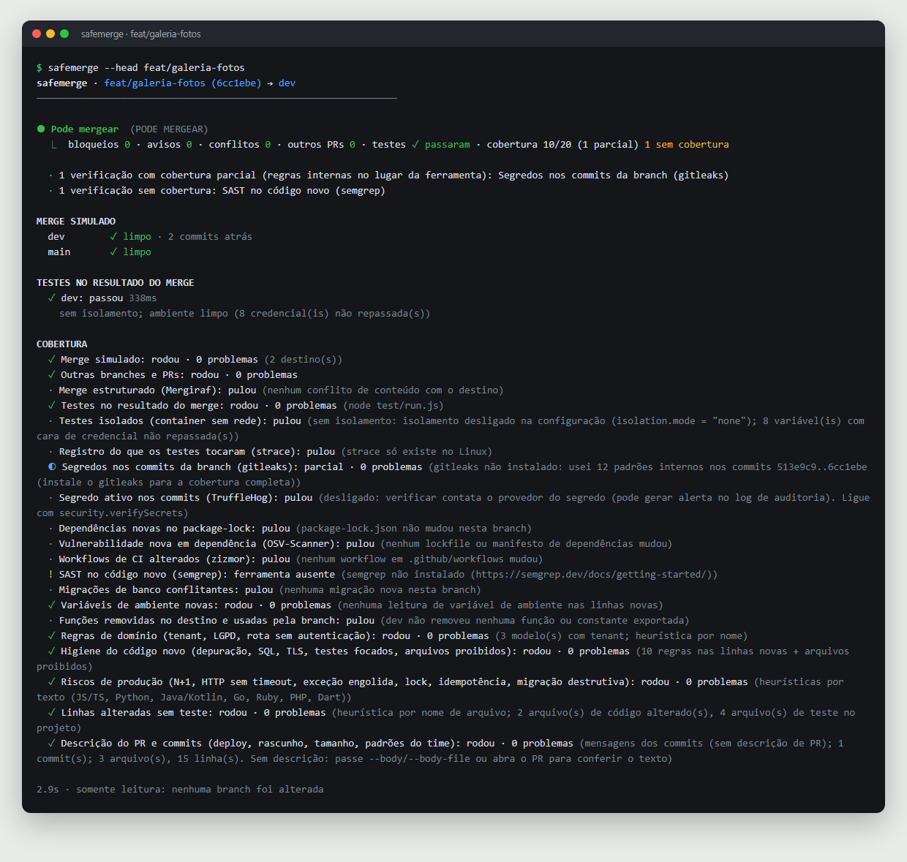
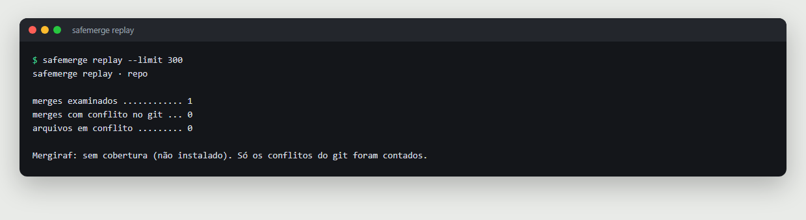
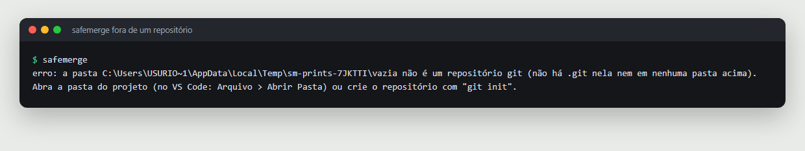

</details>

---

## Configuração

Tudo é opcional. Crie `.safemerge/config.json` no seu repositório:

```json
{
  "semantic": { "command": "npm test", "buildCommand": "npm run build" },
  "isolation": { "mode": "auto", "envAllow": ["PATH", "HOME", "DATABASE_URL_TEST"] },
  "security": { "blockSeverity": "high", "blockConfidence": "medium" },
  "migrations": { "paths": ["(^|/)prisma/migrations/"] },
  "domain": { "tenantModels": ["Orcamento", "Cliente"], "publicRoutes": ["webhook", "^/health"] }
}
```

Os valores padrão e a descrição de cada chave estão em [`src/config.ts`](src/config.ts).

### Ferramentas externas (opcionais)

| Ferramenta | Para quê | Sem ela |
| --- | --- | --- |
| [gitleaks](https://github.com/gitleaks/gitleaks) | segredos em todos os commits | regras internas (cobertura parcial) |
| [zizmor](https://github.com/zizmorcore/zizmor) | workflows do GitHub Actions | regras internas (cobertura parcial) |
| [semgrep](https://semgrep.dev) | SAST no código novo e no resultado do merge | "sem cobertura" |
| [OSV-Scanner](https://google.github.io/osv-scanner/) | CVE nova em dependência | "sem cobertura" |
| [TruffleHog](https://github.com/trufflesecurity/trufflehog) | confirma se um segredo está ativo (desligado por padrão: contata o provedor) | "pulou" |
| [Mergiraf](https://mergiraf.org) | separa conflito real de conflito só de linha | "sem cobertura" |
| Docker | testes do merge num container sem rede | roda local com ambiente limpo |
| `gh` (GitHub CLI, logado) | número, autor e título dos PRs | compara pelas branches, sem os nomes dos PRs |

## Princípios

- **Somente leitura.** Nada no seu repositório muda: merges, testes e propostas rodam em cópias
  temporárias (`git worktree`).
- **Determinístico e testado.** O núcleo é TypeScript sem IA, sem dependências em produção, com 169
  testes e um cenário de aceitação com gabarito.
- **Evidência antes de bloquear.** Sem arquivo, linha e trecho, é aviso.
- **Cobertura explícita.** O relatório diz o que rodou, o que rodou parcialmente e o que ficou sem cobertura.
- **Sem nota de 0 a 100.** Não existe padrão para isso, e uma nota esconde o que não foi verificado.
- **IA propõe, nunca aplica.** E o que ela escreve é conferido contra o relatório.

## Perguntas frequentes

<details>
<summary><b>Aparece "aviso: gh não conseguiu listar PRs". É problema?</b></summary>

Não. O `gh` só serve para dar nome aos PRs (número, autor, título). A comparação com as outras branches
continua igual. Para os nomes aparecerem, rode `gh auth login`; para sumir com o aviso, use `--no-prs`.
</details>

<details>
<summary><b>O que significa "cobertura parcial" e "sem cobertura"?</b></summary>

*Parcial*: a ferramenta especializada não está instalada e o safemerge usou as regras internas dele
(menos regras). *Sem cobertura*: a verificação não rodou. O relatório nunca transforma isso em "0 problemas".
</details>

<details>
<summary><b>Ele altera minha branch, meu índice ou meus arquivos?</b></summary>

Não. O único lugar em que escreve é `.safemerge/runs/` (com `--save`), que se ignora no git sozinho, e
`.git/hooks/pre-push` se você pedir `install-hook`.
</details>

<details>
<summary><b>Funciona com qualquer linguagem?</b></summary>

Merge, outros PRs, testes no merge, segredos, workflows, lockfiles e migrações não dependem da linguagem.
As heurísticas de código (função removida, mesma função, domínio, riscos de produção) cobrem JS/TS, Python,
Go, Java/Kotlin e partes de Ruby, PHP e Dart.
</details>

<details>
<summary><b>Funciona no Windows?</b></summary>

Sim. É desenvolvido e testado no Windows, e o CI roda também em Linux e macOS. O `strace` só existe no Linux.
</details>

## Limitações conhecidas

- As heurísticas por nome (mesma função, função removida, domínio, riscos, código sem teste) podem errar;
  por isso avisam, mas não bloqueiam sozinhas.
- As integrações com gitleaks, zizmor, semgrep, OSV-Scanner, TruffleHog, Mergiraf e Docker foram testadas
  com as saídas no formato real de cada ferramenta.
- PRs de fork só entram na comparação se a branch existir no seu remoto.

## Desenvolvimento

```bash
npm install
npm test                      # 169 testes
npm run typecheck
npm run test:complex          # cenário de produção com gabarito (acertividade e tempo)
node scripts/screenshots.mjs  # regenera as imagens deste README (Edge ou Chrome)
```

Contribuições são bem-vindas: abra uma issue com o caso (de preferência um repositório mínimo que reproduza)
ou um PR com teste.

## Licença

[MIT](LICENSE)
